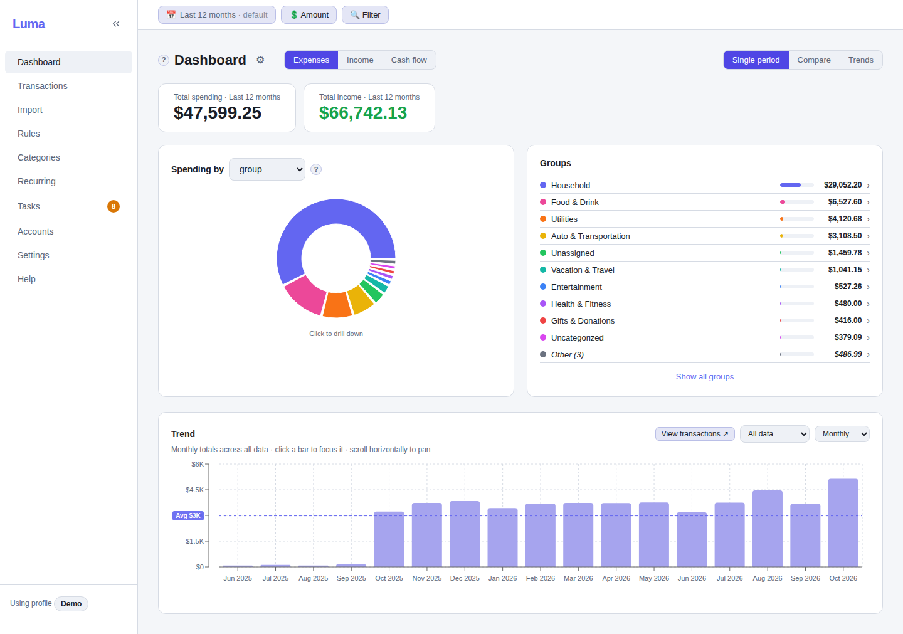
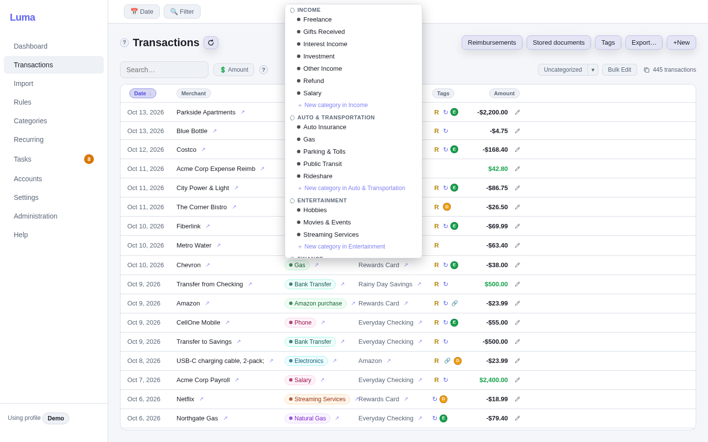
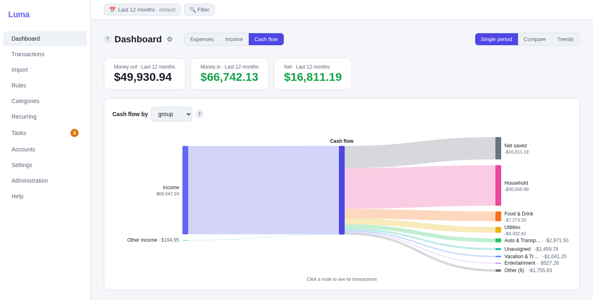
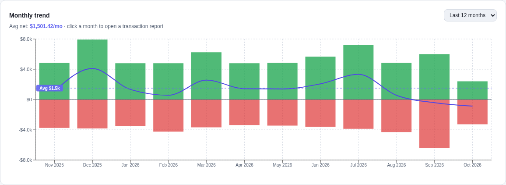
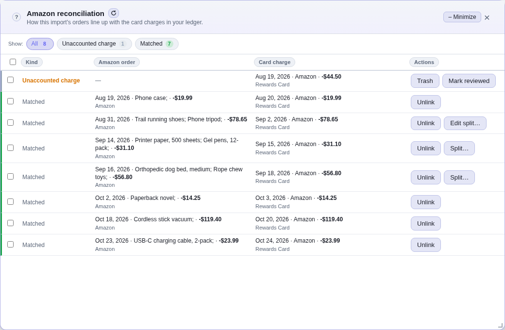
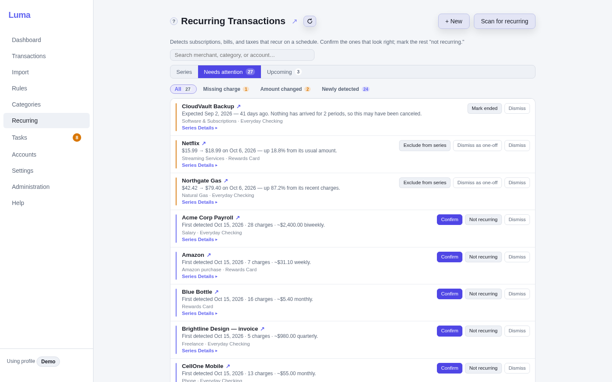

# Luma

> Understand where the money actually went.

Luma is a local-first personal finance tool. It collects transaction data from banks, cards, various spending and deposit sources and keeps it categorized to answer the question: **what was spent, on what, and how does this period compare with others.**



## Contents

- [What Luma is not](#what-luma-is-not)
- [What Luma is good at](#what-luma-is-good-at)
- [Quick start](#quick-start)
- [Features](#features)
- [Design principles](#design-principles)
- [Privacy](#privacy)
- [Security](#security)
- [Installing Luma](#installing-luma)
- [Getting started with real data](#getting-started-with-real-data)
- [Running Luma as a server](#running-luma-as-a-server)
- [Locked out](#locked-out)
- [Running from source](#running-from-source)
- [Platform support](#platform-support)
- [Tech stack](#tech-stack)
- [Documentation](#documentation)
- [Contributing](#contributing)
- [License](#license)

## What Luma is not

Two features sit at the centre of many personal finance apps, and Luma has neither. This isn’t a philosophical decision, it's just that there isn't a need for them at the moment:

- **No budgeting.** Nothing to allocate, no envelopes, no per-category targets, no alert when a category runs hot.

- **No net worth tracking.** Luma holds transactions, not balances — no asset and liability rollup, no account values over time.

Anyone whose main requirement is either of these will be better served by some other app, or they can spend the time to add them if that feels worthwhile.

**Investment accounts.** Investment accounts currently are only of interest as far as money moving in or out of them from other accounts. This one may change in the future.

**Phones.** Luma is built for a laptop or desktop sized screen, and its pages do not adapt to a small one. A tablet is about the smallest device it is comfortable on although a device with a keyboard seem helpful.

## What Luma is good at

- **Keeping the friction low** — getting data in and keeping it current should not be a project in its own right. Overlapping imports sort themselves out, and rules exists to apply categorization or edits to incoming data. Rules can be derived from imported data which is already curated to help make migration less painful.

- **Structure if it's wanted** — categories, tags and rules are not the point, examining spending is. If they are useful, they are available.

- **Recurring series detection** — automatic and helpful to pick up unwanted subscriptions,  subscription that quietly went up, a missing bill, a charge outside the range of the rule that used to catch it.

- **Staying out of the way** — if something needs changing, it can usually be changed right there without having to switch to a different page for editing.

## Quick start

1. Download the build from the [releases page](https://github.com/jeff162/luma/releases), extract it to a directory, run `luma`and Luma will open in the browser.
2. Enter a user name and choose **Load demo data**.
3. Look around. The demo data is crafted so most features can be explored.
4. When ready, use **Clear demo data** and bring in real data — see [Getting started with real data](#getting-started-with-real-data). Load demo data is on the Import page if it gets cleared by accident.
5. [Installing Luma](#installing-luma) has the detail for each platform.

## Features

- **Showing where money went** — spending by category, merchant, account or owner, with drill-down to the individual transactions, editable in place. Tags allow for custom ‘views’ of the data along any axis the user might want.

  

- **Comparing periods** — Investigate what contributes to changes in spending over time. Year-over-year and trend comparisons are built in.

- **Analyzing cash flow** — the cash-flow view nets the spending and income views. A single period is drawn as a flow diagram, from where the money came in through to the categories it went out to. The graphs can be drilled into to investigate what is behind them.

  

  

- **Getting data in** — a CSV file exported from a bank or card or a connected data source (e.g. SimpleFIN Bridge). Folder watching loads downloaded files automatically to make using CSV exports easier.

- **Re-importing just works.** Importing overlapping exports or statements from a single source ignores the already imported transactions. Activity that arrives from a different source for the same account but with slight differences is flagged as a likely duplicate for review.

- **Staying categorized over time** — rules apply categories, merchant renames and tags to matching transactions as they arrive, and can be "learned" from already categorized data and as part of the categorization process.

- **Filling in detail for marketplace purchases** — Amazon/PayPal purchases typically arrive with just the marketplace name, the amount and nothing else. The marketplace's own export adds the missing detail: Amazon order history as CSV files and PayPal activity as its monthly statement PDFs or a CSV can enrich the entries with the transaction details. In addition to providing useful information in the transaction register, this also allows the transactions to be categorized as more than just "Amazon Spending". Charges which represent multiple purchases can be split into multiple items for categorization purposes.

  

- **Splitting a transaction across categories** — a single charge that was part one thing and part another can be divided between them rather than filing the whole amount under one category. Each part can be labelled with what it covered. The Amazon reconcilliation report offers to split charges which contain multiple items to record details for the individual items.

- **Keep track of receipts** — receipt or invoice can be added to a transaction by dropping in a file or pasting from the clipboard. A PDF invoice or HTML receipt contains readable text so these are searchable alongside everything else. A photographed receipt can be stored and viewed but is not searchable as there is no OCR support.

- **Searching the history** — filter and search across the whole ledger, including exclusion filters and cross-cutting tags.

- **Finding what repeats** — subscriptions, bills, taxes and paychecks are detected as recurring series automatically, and anything the detector misses can be declared with a rule. Alerts are generated if something unexpected happens: a charge that has not turned up, a price that has moved, a series that has only just appeared, and a bill that has drifted outside the amount range its rule matches on.

  

- **Reimbursable Expenses** — Expenses which are reimbursable can be flagged so the reimbursable portion is exluded from spending. When the reimbursement arrives it is paired with the expense and it is not treated as income. Alerts exist to indicate if reimbursement is not received within the expected timeframe.

- **Multiple owners** — track personal and shared finances across several people in one ledger, with owner as a reporting axis rather than a separate set of books.

- **Backup and restore** — Backup the data, the sign-in accounts and data source credentials, with optional encryption under a key of the user's choosing, and choose what to put back when restoring. Export the data as a csv file for moving to another app or using with another too.

- **Tasks** — a running list of what needs attention, such as uncategorized transactions, issues with recurring payments, late reimbursements.

- **Multiple users** — screen layout and preferences stored on a per-user basis.

- **Runs locally or on the network** — a single-user desktop install, or a machine on the LAN that other devices reach.

## Design principles

- **Local unless told otherwise.** Everything runs on the local machine against a local SQLite database. Luma makes no outbound request except to support a user's request such as syncing a connected source, writing a backup to a network location, reading a CSV off a network drive. There is no telemetry, no analytics, nothing that phones home. One edge case is that, when enabled, Luma will check for a new version which involves fetching the current release information from GitHub. Nothing about the installation is sent.

- **Luma's job is to be helpful, not be frustrating** Anything wrong on screen should be fixable on that screen, without hunting for the settings page that owns it or the editor which allows modifications.

- **Reversible by default.** Most changes can be undone or adjusted later, and most removals go to a trash or an inactive list that can be restored from. The few that are permanent say so before they happen.

## Privacy

Luma is local-first by design, and the data stays local:

- **The data stays on the local machine** — everything is kept in a local SQLite database.

- **No tracking** — Luma has no analytics, telemetry, or "phone home."

- **Connections happen only when the user asks** — the app reaches the network only for user-driven actions, such as syncing transactions from a connected data source or reading or writing a file from/to a remote location.

- **Optional check for new releases** — off by default. When enabled Luma periodically asks GitHub for the project's latest version number. The request says nothing about the installation or its data but as with any network request, GitHub sees the address it comes from.

- **Backups stay local** — exports are saved wherever the user wishes and can be encrypted if desired with a user supplied key.

What comes in, what stays and what leaves are all the user's decision. Luma is built to organize financial data, not to collect it.

## Security

Local-first also means the security model is easy to reason about — but it's worth being clear about what protects what, and what a compromise would actually mean.

- **Transaction data is stored unencrypted on disk.** The ledger lives unencrypted in a local SQLite database, so the database files — and any **unencrypted** backup — are the artifacts to protect. Access to the machine and its files are responsible for securing these assets if they are considered sensitive. **Encrypted backup** (protected with a user-supplied key) can be generted for anything that will leave the machine.

- **The optional sign-in password is application access control.** It governs who on the local machine or network (for server installs) can reach a running instance. It does not encrypt the database, does not prevent someone from examining the database file directly with SQLite. 2FA is available for use with sign-in passwords, passkeys are available as a convenience.

- **Data-source tokens are encrypted at rest.** There is a token which authorizes Luma to interact with the data provider. Some data providers may also issue tokens for each individual account connection. Luma only uses read access but these tokens may be able to authorize transfers or payments. Since they are sensitive, all of these tokens are kept in a passphrase-protected vault. The vault passphrase is separate from the sign-in password. Losing every way into the vault means re-linking the data sources, the ledger itself is not affected. Backups of data source tokens are encrypted.

- **A household shares one vault, and each person has their own access.** When there is no vault passphrase set any user can create one. After the vault passphrase is created, a subsequent user requests access to the vault by creating their own vault passphrase which posts a request to the user(s) who can unlock the vault to approve the request. Passphrases are not revealed in the process.

  - **Vault passphrases** are best kept in a password manager as they are complex: long, and checked for how easy they are to guess. Losing vault access does not affect access to the transaction ledger, just to the data connections to refresh the account data. Losing access means rebuilding these connections. A passphrase is checked against the current strength rule each time it is typed, and its owner is asked to change it if a tightened rule finds it too easy to guess, since a backup is only as hard to break as the passphrase of the user who made it.
  - **Passkeys** can be added as an alternative access method, so a fingerprint or face check replaces retyping a long passphrase. Browsers require a secure connection to use a Passkey. The desktop app's `localhost` address works. This is part of why setting up HTTPS for a server configuration is desirable.
  - **A recovery code** can be added if there is a secure location separate from where the vault passphrase is stored. The recovery code is for when the passphrase is lost and if they are stored together, they are likely to get lost together. Printed or kept in separate secure storage is what makes it useful to have. A new recovery code is generated when it is used.

- **If a database or backup is lost or copied by someone else** and data connections are configured, Luma's access should be revoked at each connected data source so the copied credentials cannot pull anything new, or worse, be used to move money around. The process is described in **Respond to an exposure** in Vault settings (Import → Connections, with the vault unlocked). `SECURITY.md` has the full response.

## Installing Luma

Luma for a single machine is distributed as a self-contained download. The current build is available at the [releases page](https://github.com/jeff162/luma/releases).

[Running Luma as a server](#running-luma-as-a-server) describes how to deploy Luma in a server configuration.

| Platform                   | Download                            | Shape                |
| -------------------------- | ----------------------------------- | -------------------- |
| Windows                    | `luma-<version>-windows-x64.zip`    | Portable             |
| Linux (x86-64)             | `luma-<version>-linux-x64.tar.gz`   | Portable             |
| Linux ARM64 / Raspberry Pi | `luma-<version>-linux-arm64.tar.gz` | Portable             |
| macOS (Apple Silicon)      | `luma-<version>-macos-arm64.dmg`    | Drag to Applications |
| macOS (Intel)              | Not published — untested            | Drag to Applications |

**macOS (Intel) is built but not published**, because it has not been tested on an Intel Mac. A tagged release's build of it is downloadable from that run of the [Release workflow](https://github.com/jeff162/luma/actions/workflows/release.yml) (a GitHub sign-in is needed, and the files expire after 90 days), and a fresh one can be built by running the workflow with the `macos-15-intel` platform.

**The builds are unsigned.** so Windows and macOS both generate warnings about untrusted software on first run.

### Windows and Linux — portable

Unpack the download and run the luma executable. The folder *is* the installation: the
databases are created beside the executable, so moving the folder moves the data with it, and copying
it to another machine carries everything across.

On Windows, SmartScreen may object to an unsigned executable. Choose **More info**, then **Run anyway**.

On Linux, unpack the downloaded file with `tar -xzf luma-<version>-linux-x64.tar.gz`, then run with
`./luma/luma`. The Linux builds
need glibc 2.39 or newer — Ubuntu 24.04, Debian 13, Raspberry Pi OS trixie, or later.

### macOS

Pick the download matching the
machine — Apple menu → **About This Mac** names which one it is. The two are not interchangeable. Open the downloaded disk image and drag **Luma** onto the Applications shortcut.

Because the build is neither signed nor notarized, macOS refuses it on first launch. Either use a terminal window to clear the quarantine flag or in **System Settings** mark the executable so it can be run:

Clearing the quarantine flag:

```bash
xattr -dr com.apple.quarantine /Applications/Luma.app
```

Using **System Settings**

1. Double-click **Luma**, and dismiss the warning.
2. Open **System Settings → Privacy & Security**, and scroll down to **Security**.
3. Choose **Open Anyway** beside the message naming Luma, and confirm.

macOS keeps its data in `~/Library/Application Support/Luma`.

An application started from Finder has no terminal, so the startup messages go to `luma-desktop.log` in that directory.

Quit from the Dock, with Command-Q, or with **Shut down Luma** at the bottom of the navigation panel.

### Starting Luma

Luma starts a local server and opens in the browser. **It listens on loopback only**, so
nothing off the machine can reach it. Launching it again while it is already running opens a new tab against the existing instance rather than starting a second copy. Additional browser windows can be pointed at the same address if desired; it is safe to access from multiple browsers simultaneously.

There is nothing to be configured up front. Every setting has a working default.

## Getting started with real data

The first run asks for a user name and offers a choice of where the first data comes from. **Skip for now** opens the application empty, and everything below can be done from there as well.

1. **Load transactions.** Import CSV files on the Import page, connect a data provider, or both. Importing creates the accounts the transactions belong to.
2. **Set up categories.** Load the starter categories and rules, have Luma build them from the categories the imported files already carry, or start with none and add them while categorizing.
3. **Open the Dashboard** and drill into the categories to see whether the picture looks right.

**Help → How Luma works** in the application covers the same steps in more detail.

## Running Luma as a server

One computer runs Luma and the other computers on the local network open it in a browser. Everyone connected sees the same data. Sign-in protection can be enabled to control who can connect.

How to set one up with HTTPS:

- **Docker on Linux** is the easiest way.
- **On Windows**, the easiest way is to put the Caddy executable in the directory with Luma. Luma handles starting and configuring Caddy.
- **On Linux without Docker**, Caddy is installed from the distribution's packages and systemd is used to start Luma at boot and keep it running. Luma can provide the configuration files.

The steps for each are below, and the same instructions are in the application under **Help → Running Luma as a server**. A Mac can be the server as well, with Caddy and starting at boot set up using that system's own tools.

`luma --server` starts Luma in server mode and creates a name on the network, `luma.local`, to reach the app. While not recommended Luma can be configured as a server without HTTPS. The following details the issues:

|                                  | With HTTPS                                                                                                                      | Without HTTPS                                                                      |
| -------------------------------- | ------------------------------------------------------------------------------------------------------------------------------- | ---------------------------------------------------------------------------------- |
| Address the other computers open | `https://luma.local`                                                                                                            | `http://luma.local:8010`                                                           |
| What crosses the network         | encrypted                                                                                                                       | readable by anyone on the network, sign-in passwords and vault passphrase included |
| Passkeys                         | work                                                                                                                            | do not work                                                                        |
| Setting up a data provider       | from any computer                                                                                                               | only from a browser on the server                                                  |
| Setup                            | Caddy runs beside Luma to provide HTTPS. Each computer installs the server's certificate once, so its browser trusts the server | nothing further                                                                    |

The two restrictions have different causes. The passkey requirement is from the browser and cannot be worked around. The restriction around setting up a data provider comes from Luma, because secrets need to move between the user and the server and these should not pass over a network unencrypted. Syncing is still allowed from any browser, since that does not involve secrets moving over the local network.

**Without HTTPS the vault passphrase travels over the local network unencrypted.** Anyone who captures it and has a copy of either the database or a backup can extract the data provider secrets from that copy. This should be considered before using Luma in a server configuration without HTTPS.

Caddy and HTTPS are quite easy to configure. The biggest issue is that the server's certificate must be added to each client's certificate store as a trusted certificate. The sign-in page links to the certificate and to instructions for installing it.

### With Docker

On a Linux host, if Docker with the Compose plugin is available, this is a straightforward way to get Luma running as a server.

1. Save `docker-compose.yml` from the [releases page](https://github.com/jeff162/luma/releases) into a
   folder of its own.

2. Create a file named `.env` in the folder containing: `SESSION_COOKIE_SECURE=true`. If a network name other than the default `luma.local` is desired then add `MDNS_NAME=` followed by the desired name, without the `.local` ending.

3. Start it, and read the address other computers use from the log:

   ```sh
   docker compose up -d
   docker compose logs app
   ```

The data lives in a `data` folder beside `docker-compose.yml`, so backing up that folder backs up the installation. A firewall on the host has to allow TCP port 443 and UDP port 5353, and ports 80 and 443 have to be free for Caddy. Each connecting computer installs the server's certificate on its first visit, as described in [On each computer that connects](#on-each-computer-that-connects). The fingerprint for comparison is displayed by:

```sh
docker compose exec app python -m backend.desktop --certificate-fingerprint
```

Updating to a newer release is `docker compose pull` followed by `docker compose up -d`.

Docker Desktop on Windows and macOS runs containers inside a virtual machine, which does not work for a Luma server, so this only works on Linux.

If running from a source checkout, `docker compose up -d --build` builds the image from the source instead of pulling the published one.

### On Linux without Docker

Run these as the user the server should run as, from the folder the download was unpacked into.

1. Create a file named `.env` beside the program containing `SESSION_COOKIE_SECURE=true`. If a network name other than the default `luma.local` is desired then add `MDNS_NAME=` followed by the desired name, without the `.local` ending.

2. Install Caddy from the distribution's packages.

3. Give Caddy its configuration, which Luma writes for the name and port in use:

   ```sh
   ./luma --caddyfile | sudo tee /etc/caddy/Caddyfile
   sudo systemctl reload caddy
   ```

4. Install Luma as a service, so it starts whenever the computer does:

   ```sh
   ./luma --systemd-unit | sudo tee /etc/systemd/system/luma.service
   sudo systemctl daemon-reload
   sudo systemctl enable --now luma
   ```

5. Open `https://luma.local` from another computer. If a different name was chosen, `journalctl -u luma` shows the address.

A firewall on the server has to allow TCP port 443 and UDP port 5353. Changing `MDNS_NAME` or `FRONTEND_PORT` later means repeating step 3; moving the folder means repeating step 4.

### On Windows

Luma runs Caddy itself and starts when its user signs in. From the folder the download was unpacked into:

1. Create the `.env` file as in step 1 for Linux.

2. Download Caddy for Windows and put `caddy.exe` in the same folder as `luma.exe`. Luma starts, configures and stops it.

3. In a command prompt in that folder, run once:

   ```sh
   luma --start-at-sign-in
   ```

   From the next sign-in on, Luma starts as a server with no window, behind an icon in the notification area that shows the address, opens Luma, and stops and starts it. `luma --server --tray` starts it straight away, and `luma --no-start-at-sign-in` undoes the step.

4. The first time each one runs, Windows Firewall asks which networks may reach Caddy and which may reach Luma. **Private networks** covers the other computers in a household; **Public networks** also lets anyone on a public network the server joins reach the sign-in page. If the other computers still cannot connect, Windows may be treating the home network as public; the profile is set under the network's properties in Windows Settings.

The server runs while that user is signed in. Replacing `luma.exe` with a newer version in the same folder, after choosing **Exit** on the icon, needs nothing further. After moving the folder, or unpacking a newer version into a different one, run `luma --start-at-sign-in` again from there.

**To start with the computer instead, with nobody signed in**, use a scheduled task in place of step 3:

1. In **Task Scheduler**, choose **Create Task** and select **Run whether user is logged on or not**.
2. Add a trigger of **At startup**, and an action that starts `luma.exe --server` from its folder.
3. Clear **Stop the task if it runs longer than 3 days** and, on a laptop, **Start the task only if the computer is on AC power**.

A server started this way has no icon in the notification area. Its address is on the start line of `luma.log`, beside the data.

### On each computer that connects

The first visit shows a browser warning, because Caddy issues its own certificate and no computer trusts it yet. Continue past the warning once, choose **Browser warning about this server? Install its certificate** on the sign-in screen, and follow the steps shown for that kind of computer. Once the browser is closed and reopened the warning is gone. With sign-in protection off there is no sign-in screen; the same download and steps are under **Settings → Server certificate**.

To be sure a computer received the server's own certificate, compare the fingerprint it shows against the one printed on the server by `luma --certificate-fingerprint`. **Settings → Server certificate** also has a box that takes a fingerprint and reports whether it matches.

## Locked out

A forgotten password is reset from a terminal on the computer that holds the data, by running Luma with`--reset-password`:

| Installation              | Command                                                                  |
| ------------------------- | ------------------------------------------------------------------------ |
| Windows or Linux download | `luma --reset-password`, in the folder holding the program               |
| macOS                     | `/Applications/Luma.app/Contents/Resources/server/luma --reset-password` |
| Docker                    | `docker compose exec app python -m backend.desktop --reset-password`     |
| Source checkout           | `backend/venv/bin/python -m backend.desktop --reset-password`            |

It lists the accounts to choose from and asks for the new password, and is safe to run while Luma is running. The account chosen ends up as an active administrator with two-factor sign-in off, and current browser sessions are signed out. The vault passphrase is not affected.

## Running from source

Running from a checkout needs Python 3.12 or newer and Node.js 22.12+, and is the arrangement for working *on* Luma rather than with it. `CONTRIBUTING.md` has the setup, the useful checks and the project conventions.

An optional `.env` file overrides the handful of values resolved before the app is running — the ports, the data directory (`DATA_DIR`, holding both databases, the `documents` folder of attachments and the `luma.log` error log), and the developer-options gate. Copy `env_example.txt` to `.env` to use it.

## Platform support

Windows, macOS, Linux, and Raspberry Pi (Raspberry Pi OS and other ARM Linux distributions). On a Pi, performance depends on the model, storage speed, and whether it runs directly or through Docker.

Each Linux download carries a minimum glibc, because the build links against the C library of the machine that produced it. Both are compiled on Ubuntu 24.04 and need **glibc 2.39 or newer**, which covers Ubuntu 24.04, Debian 13, Raspberry Pi OS trixie and everything after them. The ARM64 download is also **64-bit only** — a 32-bit Raspberry Pi OS is a different architecture and has no build.
Running from source has none of these restrictions, and the Docker image carries its own C library, so the glibc minimum does not apply to it.

Python 3.12 is what Luma is built on, and the test suite also runs on 3.14. (This applies to running from source; the downloads carry their own runtime.)

## Tech stack

| Layer     | Technology                         |
| --------- | ---------------------------------- |
| Backend   | Python 3.12 / FastAPI / SQLite     |
| Frontend  | React 19 / Vite / Recharts         |
| Bank data | Plaid or SimpleFIN (both optional) |

## Documentation

- **[CONTRIBUTING.md](CONTRIBUTING.md)** — development setup, checks, and project conventions
- **[SECURITY.md](SECURITY.md)** — the security model, what is in scope, and how to report a vulnerability
- **[CHANGELOG.md](CHANGELOG.md)** — what changed between releases
- **[docs/architecture.md](docs/architecture.md)** — application structure, data flow, and major subsystems
- **[docs/data-model.md](docs/data-model.md)** — core entities, relationships, and the invariants that hold them together
- **[docs/security-model.md](docs/security-model.md)** — what is defended and what deliberately is not, and why the design is shaped the way it is
- **[docs/operations.md](docs/operations.md)** — running an instance: topologies, configuration, restore, and diagnosing
- **[docs/scale-and-limits.md](docs/scale-and-limits.md)** — what breaks at volume, what is capped on purpose, and why
- **[docs/ui-patterns.md](docs/ui-patterns.md)** — interaction patterns and shared UI behavior
- **[docs/mechanism-index.md](docs/mechanism-index.md)** — which mechanism is which: splits, purchases, recurring series, reimbursements
- **[docs/shared-components.md](docs/shared-components.md)** — which shared component to use for what
- **[docs/building-a-connector.md](docs/building-a-connector.md)** — adding a data source
- **[docs/releasing.md](docs/releasing.md)** — building the downloadable artifacts and cutting a release
- **[docs/backlog/](docs/backlog/)** — deferred and parked work, one file per initiative
- **[docs/README.md](docs/README.md)** — an index of every document in `docs/` and its sections

In the application itself, **Help → How Luma works** covers the same model from the user's side.

## Contributing

Luma is early-stage and evolving. Bug reports, feedback and pull requests are welcome — open an
issue to discuss an idea or a defect, and see [CONTRIBUTING.md](CONTRIBUTING.md) before submitting
changes. Participation is governed by the [Code of Conduct](CODE_OF_CONDUCT.md).

Two things worth knowing before proposing a feature: Luma deliberately has **no budgeting and no net
worth tracking** (see *What Luma is not* above), and there is a set of projects already designed and
queued in [docs/backlog/](docs/backlog/) — commenting on an existing plan is more useful than a new
issue.

## License

This project is licensed under the GNU Affero General Public License v3.0 or later (AGPL-3.0-or-later).

See the [LICENSE](LICENSE) file for full details.
